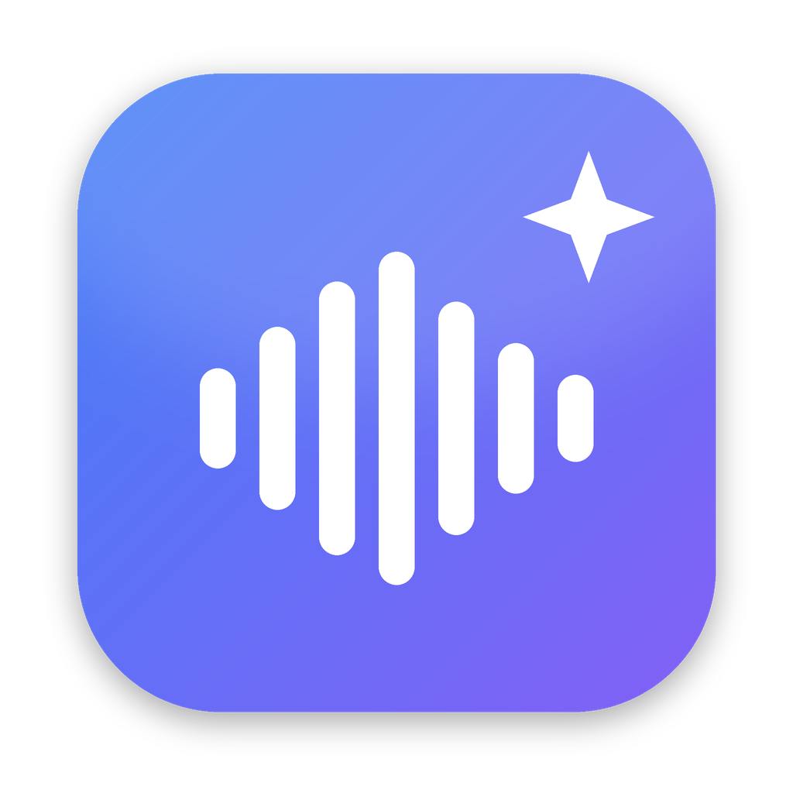
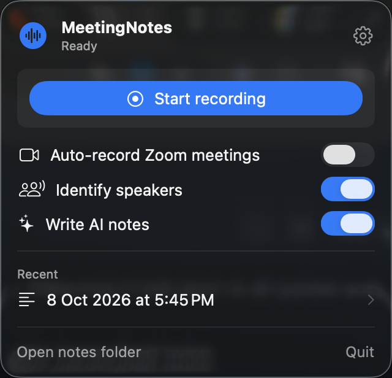
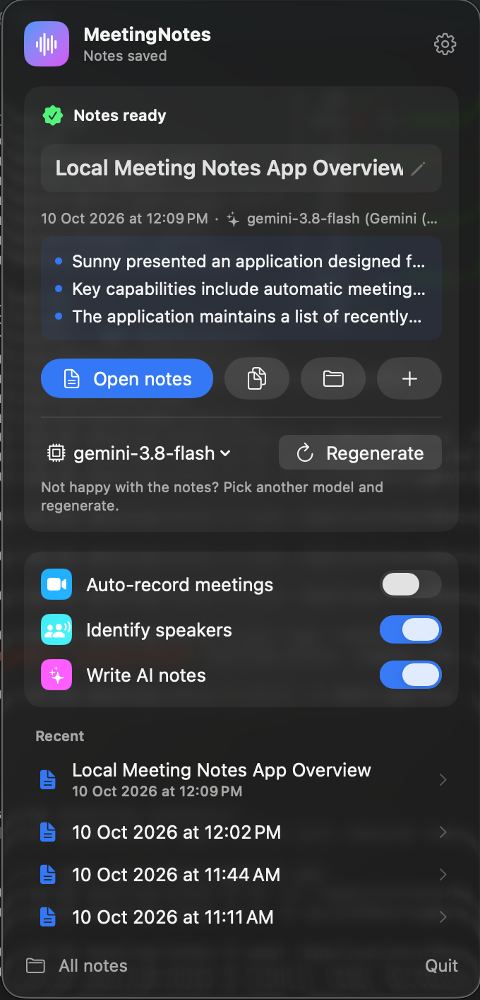
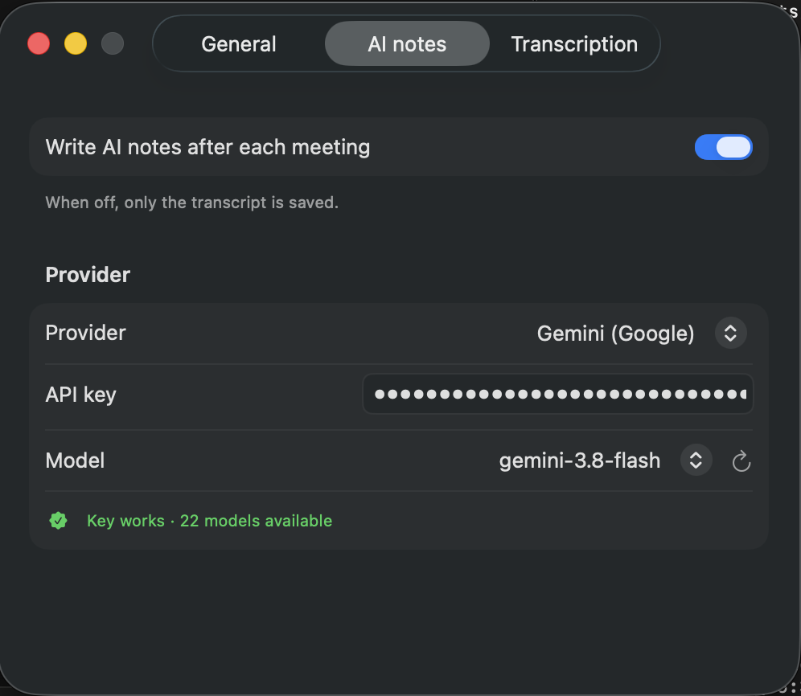
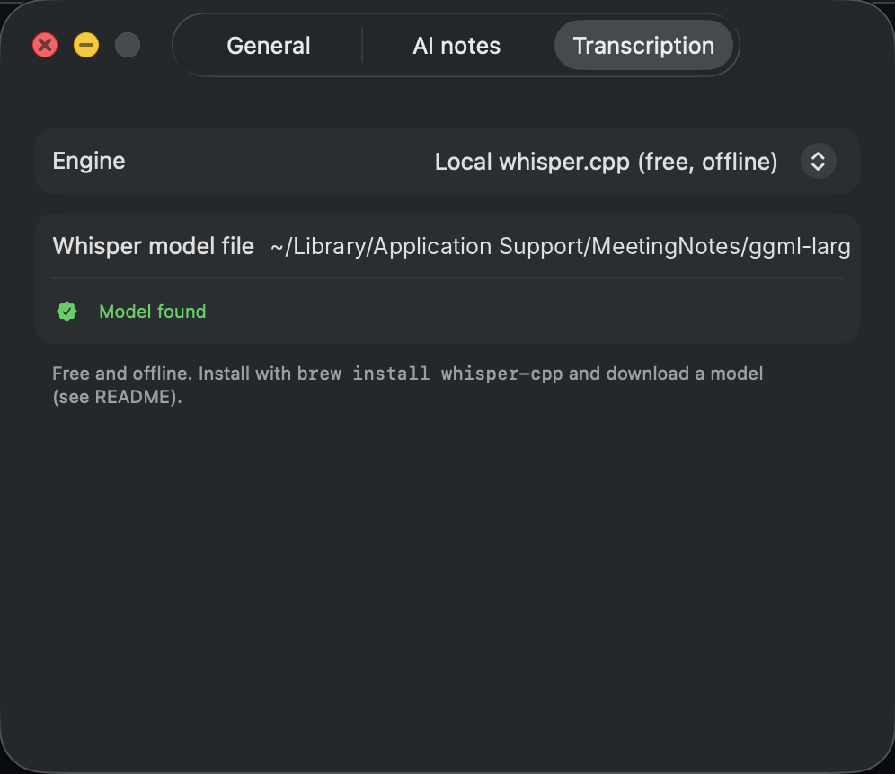

# MeetingNotes

A free, open-source, lightweight macOS menu-bar app that records online meetings **locally** (Zoom,
Google Meet and Microsoft Teams) and turns them into a short summary plus long, detailed notes, using
your own Claude, OpenAI, Gemini or Mistral API key, or completely free and offline with Ollama.

No bot joins the call and the audio stays on your Mac. Recording laws differ by country and company;
see [Responsible use](#responsible-use).

| App | Recording | Auto-record | Speaker names |
|---|---|---|---|
| Zoom (desktop app) | Zoom's audio only | ✅ | ✅ green border (Gallery view) |
| Google Meet (Chrome, Edge, Arc, Brave, Safari, Firefox) | All system audio | ✅ macOS 14.4+ | 🧪 blue border (grid view) |
| Microsoft Teams (desktop app) | All system audio | ✅ macOS 14.4+ | 🧪 purple border (gallery view) |

🧪 = experimental: the Meet and Teams highlight colours are tuned from their UI but not yet tested
widely. If they miss, lines fall back to `Not recognised`, and the notes still get the participant names
read from the screen. The colours live in `MeetingApp.isHighlight` and are easy to adjust.

| Writing notes | Notes ready: rename, preview, regenerate |
|---|---|
|  |  |

| AI notes settings | Transcription settings |
|---|---|
|  |  |

**Contents:** [Features](#features) · [Example output](#example-output) · [How it works](#how-it-works) ·
[Why two AI models](#why-two-different-ai-models) · [Whisper & the model file](#transcription-whisper-ggml-and-large-v3-turbo-q5_0) ·
[Project structure](#project-structure) · [Setup on a new Mac](#setting-up-on-a-new-mac) ·
[Troubleshooting](#troubleshooting) · [Privacy](#privacy)

## Features

- **Records locally:** the meeting's audio (the other participants) through ScreenCaptureKit, and your
  voice through the microphone, as separate tracks. Nothing leaves your Mac except the transcript sent to the AI provider you pick.
- **Any accent, or any language:** Whisper is trained on audio from speakers all over the world. By
  default transcription is set to English with a meeting-vocabulary hint (most accurate for accented
  English); switch *Language* to **Auto-detect** for meetings in other languages. The AI is told to fix
  obvious mishearings from context and to write the notes in the meeting's language.
- **Who said what:** meeting apps put a coloured border around the active speaker (Zoom green, Meet
  blue, Teams purple). About once a second the app finds that border inside the meeting window and
  reads the name label with on-device OCR (Apple Vision), so the transcript says `Priya Sharma:` instead
  of `Others:`. Frames are never saved.
- **Participant list:** every ~15 s all name labels in the meeting window are read too, and passed to
  the notes AI so names are spelled right even for people who never got highlighted.
- **Audio-only fallback:** if the meeting window is minimised, on another Space, or (Meet) its tab is in
  the background, recording carries on, those lines are labelled `Not recognised`, and speaker
  detection resumes on its own when the window is back.
- **Bring your own AI, or run it locally:** Claude (Anthropic), ChatGPT (OpenAI), Gemini (Google), Mistral,
  or **Ollama** for a fully local, free and offline pipeline (no API key). The model list is fetched live from the
  provider, so new models appear without an app update. Keys are kept in the macOS Keychain.
- **Free transcription:** offline `whisper.cpp`, or the OpenAI Whisper API if you prefer.
- **Regenerate with another model:** if a (small, local) model writes weak notes, pick a different one
  in the menu and regenerate from the saved transcript in seconds.
- **Named and organised:** the notes AI suggests a short title, and the meeting is saved as
  `2026-10-10 1111 · Sprint planning`. After saving you can rename it right in the menu (✓ to save,
  ✕/Esc to keep the saved name), and every recent meeting can be renamed, copied, shown in Finder or
  moved to the Trash (hover or right-click).
- **Hands-free:** optional auto-record when a Zoom, Meet or Teams call starts (and stop when it ends),
  launch at login, and a macOS notification when the notes are ready.

## Example output

Each meeting gets a folder in `~/Documents/MeetingNotes/<date time> · <title>/`. The example below is fictional.

`transcript.md`

```text
[00:04] Alex: Morning all. Quick one today, the release plan and the login bug.

[00:11] Priya Sharma: So the fix is merged, but QA found one more edge case with expired sessions.

[00:24] James Carter: Can we still ship on Thursday, or do we push to Monday?

[00:31] Not recognised: I think Thursday is fine if QA signs off by Wednesday evening.
```

`notes.md`

```markdown
## Summary
- Login bug fix is merged; one edge case with expired sessions remains.
- Release stays on Thursday if QA signs off by Wednesday evening.

## Decisions
- Keep the Thursday release date, conditional on QA sign-off.

## Action items
- [ ] Fix the expired-session edge case (Priya Sharma, Wednesday)
- [ ] QA sign-off on the release build (QA team, Wednesday evening)

## Open questions
- Who owns the rollback plan if sign-off slips?

## Detailed notes
### Login bug
Priya confirmed the fix is merged. QA reproduced one more case where an expired session ...

### Release plan
James asked whether Thursday is still realistic ...
```

## How it works

### The flow

```text
                ┌──────────────── during the meeting ────────────────┐
 Meeting audio ─┤ ScreenCaptureKit ─► 16 kHz mono WAV, 10-min chunks │──┐
 Your mic ──────┤ AVAudioEngine    ─► 16 kHz mono WAV, 10-min chunks │──┤
 Meeting window ┤ 1 frame/sec ─► highlight ─► OCR name ─► timeline  │──┼──┐
                └────────────────────────────────────────────────────┘  │  │
                ┌──────────────── after you press Stop ──────────────┐  │  │
                │ 1. Speech → text   whisper.cpp (local) or Whisper API ◄─┘  │
                │ 2. Who said it     mic = you, meeting audio = name ◄───────┘
                │                    from the timeline, else "Not recognised"
                │ 3. Save            transcript.md
                │ 4. Text → notes    your AI (Claude/OpenAI/Gemini/Mistral, or local Ollama)
                │ 5. Save            notes.md, delete the audio, notify you
                └────────────────────────────────────────────────────┘
```

1. **Detect the meeting (no AI needed).** The app is identified by its bundle id (Zoom, Teams) or, for
   Google Meet, by a browser window titled "Meet – …". A call is "on" when that app is using the
   microphone (macOS 14.4+ reports this per app) or, for Zoom, while its `CptHost` meeting helper runs.
   *Auto-record* starts then and stops a few seconds after the call ends. You can also press
   *Start recording* yourself.
2. **Capture.** Two separate audio tracks are recorded: the meeting's audio (everyone else) through
   ScreenCaptureKit, and your microphone. For Zoom only Zoom's own audio is taken; Meet and Teams play
   sound from helper processes, so for them all system audio is recorded (mute music and videos). Keeping them separate means
   every line from the mic is you, with no guessing. Both are converted on the fly to 16 kHz mono,
   the format Whisper expects, and written in 10-minute WAV chunks so a long meeting never builds one
   huge file (and each chunk stays under the Whisper API's 25 MB upload limit).
3. **Speaker detection** runs in parallel: about once a second the meeting window is checked for the
   app's active-speaker border colour, and the name in that tile is read with Apple's on-device OCR.
   Every ~15 s all name labels in the window are read as well, giving a participant list. This
   produces a timeline like `00:31 Priya Sharma, 00:32 Priya Sharma, 00:40 James Carter`. Frames are
   analysed in memory and thrown away.
4. **Transcribe.** After you stop, each chunk goes through Whisper, which returns text with start
   and end times. Chunk offsets turn those into meeting times.
5. **Name the lines.** Mic lines get your name. For each meeting-audio line the app looks up who the
   timeline says was highlighted during those seconds; if nobody was (window hidden, speaker view), the
   line is `Not recognised`. Lines are sorted by time and consecutive lines by the same person merged.
6. **Write notes.** The transcript, the speaker list, the names seen on screen and a fixed instruction
   prompt go to the AI provider you picked. Where the conversation makes it obvious ("Thanks, Priya"),
   the AI may mark a `Not recognised` speaker as "likely Priya", but it is told not to guess otherwise. It returns the Summary, Decisions, Action items, Open questions and Detailed
   notes as Markdown.
7. **Clean up.** `transcript.md` and `notes.md` are saved, the WAV files are deleted, and you get a
   notification. If any step fails the audio is kept so **Retry** can run steps 4–7 again.

### Why two different AI models?

Turning a meeting into notes is two different jobs, and no single small model does both well:

| | Speech-to-text (Whisper) | Notes (Claude / GPT / Gemini / Mistral / Ollama) |
|---|---|---|
| Input | Audio | Text (the transcript) |
| Output | What was said, word for word, with timestamps | What it *means*: summary, decisions, owners |
| Understands the meeting? | No. It only hears sounds and writes words | Yes. It reads the whole meeting at once |
| Runs | On your Mac, free (or OpenAI's API) | In the provider's cloud with your API key, or on your Mac with Ollama |

**Why your own API key?** Writing good notes needs a large language model: one that can read an
hour of conversation, fix words Whisper misheard ("cube control" → "kubectl") from context, notice
that a decision was made 20 minutes after it was first discussed, and attribute action items to the
right person. Models that do this well are far too big to run on a laptop, so the app calls one
through the provider's API. There is no MeetingNotes server in between: the transcript goes straight
from your Mac to the provider you chose, under your own account. That is why you bring the key, pay
the provider directly (a one-hour meeting is roughly 10–15k words, typically a few cents to a few tens
of cents depending on the model), and can switch providers or models at any time. Keys are stored in
the macOS Keychain. Turn *Write AI notes* off and nothing is sent anywhere; you just get the transcript.

**Or keep everything local with Ollama.** [Ollama](https://ollama.com) runs open models (Llama, Qwen,
Gemma, Mistral…) on your Mac's GPU. Pick *Ollama (local, free)* as the provider and no key is needed:
the transcript never leaves your machine and there is no cost. Smaller local models write simpler notes
than the big cloud ones and take longer on long meetings, so pick the biggest model your RAM allows.
The app uses Ollama's own chat API and sets the context window (`num_ctx`) to fit the transcript,
because Ollama's default window is only a few thousand tokens and it silently cuts longer input.

### Transcription: Whisper, GGML and `large-v3-turbo-q5_0`

**Whisper** is OpenAI's open-source speech-recognition model. It is a transformer trained on a very
large amount of real-world audio from speakers all over the world, which is why it copes well with
many different accents. It works on 30-second windows: the audio is turned into a spectrogram (a picture of which
frequencies are loud at each moment), an *encoder* turns that into a representation of the sounds,
and a *decoder* writes the text one token at a time, with timestamps.

**whisper.cpp** is a C/C++ re-implementation of Whisper that runs entirely on your Mac (and can use
the Apple Silicon GPU). No audio leaves the machine and there is no per-minute cost. The app runs
it as a command-line tool (`whisper-cli`) on each chunk.

**GGML** is the tensor library behind whisper.cpp, and `.bin` files in its format hold the model's
weights. That is why the model is a separate download from `brew install whisper-cpp`: the program
and the trained weights are two different things.

**What the file name means:** `ggml-large-v3-turbo-q5_0.bin`

| Part | Meaning | Why this choice |
|---|---|---|
| `large-v3` | Whisper's largest, most accurate model generation | Best accuracy on accents and technical words |
| `turbo` | large-v3 with the decoder cut from 32 layers to 4 | Several times faster, with only a small accuracy loss |
| `q5_0` | Weights quantised from 16-bit to about 5-bit numbers | ~550 MB instead of ~1.6 GB, less memory, faster, near-identical output |

Together this gives close to the best Whisper accuracy at a size and speed that suits a laptop. On
Apple Silicon it transcribes much faster than real time. On slower machines a smaller model trades
accuracy for speed; download it from the
[whisper.cpp model list](https://huggingface.co/ggerganov/whisper.cpp/tree/main) and set its path
in Settings → Transcription:

| Model file | Size | When to use |
|---|---|---|
| `ggml-large-v3-turbo-q5_0.bin` | ~550 MB | Default: best balance of accuracy and speed |
| `ggml-small.en-q5_1.bin` | ~190 MB | Older or Intel Macs; less accurate on strong accents |
| `ggml-large-v3.bin` | ~3 GB | Maximum accuracy, much slower |

**Two settings make it better for this use:**

- **Language is English by default.** Otherwise Whisper may mistake accented English for another
  language and write the wrong script or translate. For meetings in other languages, set
  Settings → Transcription → Language to **Auto-detect**: Whisper then detects the language from the
  first 30 seconds of each 10-minute part, and the English prompt hint is left out so it doesn't nudge
  the output towards English.
- **A prompt hint** ("a work meeting in English with speakers of different accents, discussing
  product, engineering and business topics") is passed as Whisper's initial prompt, which nudges its
  spelling and vocabulary.

The **OpenAI Whisper API** option runs the same kind of model on OpenAI's servers instead: nothing
to install, but the audio is uploaded and billed per minute, and it needs an OpenAI key.

## Project structure

```text
mac-app/
├── LICENSE                      MIT
├── README.md                    List of apps in this repo
└── meeting-notes/
    ├── Package.swift            Swift Package: macOS 13+, no third-party dependencies
    ├── Resources/Info.plist     Bundle id, menu-bar-only app (no Dock icon), microphone prompt text
    ├── scripts/build_app.sh     Builds a release binary, wraps it into MeetingNotes.app, signs it ad hoc
    ├── Resources/AppIcon.icns   App icon (regenerate with scripts/make_icon.py, needs Pillow)
    ├── docs/                    Screenshots and the icon used in this README
    └── Sources/MeetingNotes/
        ├── MeetingNotesApp.swift   App entry point and the Settings window (General, AI notes, Transcription)
        ├── MenuView.swift          Menu-bar popover: recording card, progress steps, rename/preview card, recent list
        ├── MeetingApp.swift        Zoom / Meet / Teams: bundle ids, highlight colours, call detection
        │                           (mic usage per app, window titles)
        ├── AppModel.swift          State (idle → recording → processing → done/failed), auto-record,
        │                           runs the pipeline, recent meetings
        ├── Recorder.swift          ScreenCaptureKit (meeting audio + frames), microphone, 16 kHz WAV chunk writer
        ├── SpeakerDetector.swift   Highlight detection, Vision OCR, window-visible check, speaker timeline,
        │                           participant names
        ├── Transcriber.swift       whisper.cpp / Whisper API calls, timestamps, transcript formatting
        ├── LLM.swift               Notes prompt; Anthropic API, OpenAI-compatible API (OpenAI, Gemini,
        │                           Mistral) and Ollama's local API; live model lists
        ├── Support.swift           Providers, preferences, Keychain, HTTP helper
        └── System.swift            Launch at login, macOS notifications
```

Built with Apple frameworks only: SwiftUI, ScreenCaptureKit, AVFoundation, Vision, ServiceManagement,
UserNotifications and Security (Keychain).

## Setting up on a new Mac

Needs macOS 13 (Ventura) or newer, on Apple Silicon or Intel. Takes about 10 minutes, most of it downloads.

### 1. Install the tools (one time)

```bash
# Swift compiler (skip if Xcode is installed; `swift --version` should work afterwards)
xcode-select --install

# Homebrew (skip if `brew --version` already works)
/bin/bash -c "$(curl -fsSL https://raw.githubusercontent.com/Homebrew/install/HEAD/install.sh)"

# Free, offline speech-to-text
brew install whisper-cpp
```

### 2. Download the speech model (one time, ~550 MB)

```bash
mkdir -p ~/Library/Application\ Support/MeetingNotes
curl -L -o ~/Library/Application\ Support/MeetingNotes/ggml-large-v3-turbo-q5_0.bin \
  https://huggingface.co/ggerganov/whisper.cpp/resolve/main/ggml-large-v3-turbo-q5_0.bin
```

Skip steps 1–2 for whisper if you will use the **OpenAI Whisper API** for transcription instead
(Settings → Transcription); that uploads the audio to OpenAI and needs an OpenAI key.

### 3. Get the code and build the app

```bash
git clone https://github.com/sunny-github69/mac-app.git
cd mac-app/meeting-notes
./scripts/build_app.sh                      # creates build/MeetingNotes.app
cp -R build/MeetingNotes.app /Applications/ # needed for "Launch at login"
open /Applications/MeetingNotes.app
```

A waveform icon appears in the menu bar (top right). There is no Dock icon; that is expected.

> Keep the repo out of iCloud Drive / OneDrive / Dropbox folders: the build creates thousands of
> files in `.build/` and the sync client will slow it down.

### 4. Configure

Click the menu-bar icon, then the ⚙︎ button in the top-right corner of the popover:

- **AI notes**: pick a provider and paste its API key, or pick **Ollama (local, free)** (no key; Ollama
  must be running and have a model, e.g. `ollama pull llama3.1`). The **Get a key** link opens the right page:
  [Anthropic](https://console.anthropic.com/settings/keys), [OpenAI](https://platform.openai.com/api-keys),
  [Google AI Studio](https://aistudio.google.com/app/apikey) or [Mistral](https://console.mistral.ai/api-keys).
  Each provider's key is saved separately, so you can switch between them. It is checked live ("Key works · N models")
  and the model list loads; pick a model. Keys are stored in the macOS Keychain, never in files.
  Turn AI notes off to save only the transcript.
- **General**: *Launch at login*, *Auto-record when a Zoom, Meet or Teams call starts*, your name (used instead
  of "You" in the transcript), and *Identify who is speaking*.
- **Transcription**: local whisper.cpp (shows "Model found" if step 2 worked) or the OpenAI API, and the
  language: *English* (default, best for any accent) or *Auto-detect* (meetings in other languages).

The three main switches (auto-record, speakers, AI notes) are also in the menu-bar popover.

### 5. Grant permissions and do a test recording

1. Start a Zoom, Google Meet or Teams meeting (alone is fine) and switch to the **grid / gallery view**.
   Use headphones.
2. Press **Start recording**. macOS asks for:

   - **Microphone** → Allow.
   - **Screen & System Audio Recording** → open System Settings → Privacy & Security → enable
     *MeetingNotes*. macOS may ask you to quit and reopen the app; do so and start again.
3. While recording, the popover shows a timer and who is speaking, e.g. "Priya Sharma is speaking".
   Minimise the meeting window (or switch away from the Meet tab) and it shows
   "Google Meet not visible – notes from audio only".
4. Press **Stop & write notes**. When the notification arrives, click it (or **Open**) to read the notes.

To test speaker names, join the same meeting from a phone and talk from there.

### Daily use

- **Manual:** menu-bar icon → **Start recording** → **Stop & write notes**.
- **Automatic:** turn on **Auto-record meetings**. Recording starts when you join a meeting and
  the notes are written when you leave. Pressing Stop mid-meeting stops it for that meeting.
- When notes are ready the menu shows the name, the app, which model wrote the notes, a short
  summary preview and **Open / Copy / Finder / New** buttons. Type a new name and press Return (or ✓)
  to rename; Esc or ✕ keeps the saved name.
- **Not happy with the notes?** In the same card pick another model from the dropdown and press
  **Regenerate**: the notes are rewritten from the saved transcript (no new transcription). If it fails,
  the previous notes stay. This is available for the latest meeting.
- The last five meetings are listed under **Recent**: click to open, hover for ✏️ rename and 🗑 trash,
  right-click for more. **All notes** opens the folder with every meeting.

### Updating

```bash
cd mac-app/meeting-notes
git pull
pkill -x MeetingNotes                       # quit the running copy (ignore "no process found")
./scripts/build_app.sh
rm -rf /Applications/MeetingNotes.app
cp -R build/MeetingNotes.app /Applications/
open /Applications/MeetingNotes.app
```

#### Keep permissions across rebuilds (recommended)

By default the app is ad-hoc signed, and macOS treats every rebuild as a new app, so it asks for
Screen & System Audio Recording again even though *MeetingNotes* is already switched on. Fix it once
with a free, local signing certificate:

1. Open **Keychain Access** → menu **Keychain Access → Certificate Assistant → Create a Certificate…**
2. Name: `MeetingNotes Local`, Identity Type: **Self Signed Root**, Certificate Type: **Code Signing**
   → **Create**.
3. Clear the old permission once, rebuild and allow it again:
   ```bash
   tccutil reset ScreenCapture com.local.meetingnotes
   tccutil reset Microphone com.local.meetingnotes
   ./scripts/build_app.sh        # prints: Signed with "MeetingNotes Local"
   ```

From now on rebuilds keep the permission. (If you skip this: after each update, remove *MeetingNotes*
from Privacy & Security → Screen & System Audio Recording with **−**, then allow it again.) Settings
and API keys are kept either way.

### Troubleshooting

| Problem | Fix |
|---|---|
| `cd: no such file or directory` | Run the commands from the folder you cloned into (`pwd` shows where you are). |
| `swift: command not found` | `xcode-select --install`, then open a new terminal. |
| "whisper.cpp not found" | `brew install whisper-cpp` |
| `brew` says "You are using macOS on Intel x86_64" on an Apple Silicon Mac | You have an old Intel Homebrew in `/usr/local` (often migrated from an older Mac). Install the native one in `/opt/homebrew` (step 1), run `echo 'eval "$(/opt/homebrew/bin/brew shellenv)"' >> ~/.zprofile`, open a new terminal, check `which brew` shows `/opt/homebrew/bin/brew`, then install whisper-cpp again. |
| "Whisper model not found" | Redo step 2, or fix the path in Settings → Transcription. |
| Notes have no "Others" lines | Screen & System Audio Recording permission is missing; grant it and reopen the app. |
| Every line is "Not recognised" | Use the grid/gallery view and keep the meeting window visible (Meet: keep its tab in front). For Meet/Teams the highlight colour may need tuning in `MeetingApp.isHighlight`. |
| Auto-record doesn't start for Meet/Teams | Needs macOS 14.4+. For Meet, the tab title must start with "Meet". Otherwise press Start manually. |
| Asks for Screen Recording again although it's already on | The rebuild changed the app's signature. See [Keep permissions across rebuilds](#keep-permissions-across-rebuilds-recommended). |
| "Couldn't change login item" | Move the app to `/Applications` first. |
| API error | Check the key and the account's credit in the provider's console. |
| "Can't reach Ollama" | Open the Ollama app (or run `ollama serve`), then press ↻ next to Model. |
| Ollama: "… was retired" or the model needs a sign-in | It was an Ollama *cloud* model. The app now lists only local models; pick one (e.g. `llama3.1`) and press **Retry**. |
| Ollama: "No models installed" | `ollama pull llama3.1` (or any chat model), then press ↻. |

### Uninstall

```bash
rm -rf /Applications/MeetingNotes.app ~/Library/Application\ Support/MeetingNotes
defaults delete com.local.meetingnotes
```
Meeting notes in `~/Documents/MeetingNotes` are left alone.

## Limitations
- Speaker names need the grid/gallery view and the meeting window visible (not minimised; for Meet,
  the tab in front). Speaker-only views have no highlight border, so those lines become `Not recognised`.
- Meet and Teams speaker detection is experimental (highlight colours not widely tested).
- Meet and Teams record all system audio, so mute other audio during the call.
- Join the meeting before pressing Start; with no meeting app detected, all system audio is recorded
  and speaker names are off.
- Use headphones, otherwise meeting audio leaks into your mic and gets transcribed twice.
- Speaker names come from OCR of the meeting UI and can lag by a line, or misread an unusual name.
- The meeting window must be on the main display.

## Responsible use

You are responsible for how you use this app. Recording laws differ by country and state (some require
every participant's consent), and many employers have recording policies. Check both before recording
a meeting without telling people.

## Privacy

- Audio and meeting-window frames are processed on your Mac. Frames are never written to disk.
- With Ollama, nothing leaves your Mac at all.
- Otherwise the transcript is sent only to the AI provider you choose (and, if you pick the OpenAI Whisper API,
  the audio is uploaded to OpenAI).
- API keys are stored in the macOS Keychain, not in files or in this repository.

## License

[MIT](../LICENSE)
